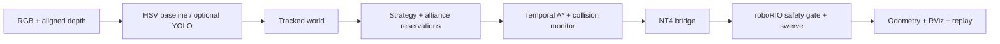

# 2018 Offseason · Dynamic Autonomy

FIRST POWER UP sahası için kişisel bir FRC otonomi denemesi. Kod hiçbir yarışmada kullanılmadı. Java roboRIO katmanı ve Python/ROS 2 Jetson katmanı, algılanan küpler ve hareketli engellere göre hedef/rota seçer. Gerçek robot ve kamera performansı henüz doğrulanmadı.

A personal FRC autonomous experiment for the 2018 POWER UP field, never used in competition. Java roboRIO code and a Python/ROS 2 coprocessor layer combine target selection, temporal path planning, collision filtering and a bounded NetworkTables command link. Hardware performance is unverified.

## Hızlı demo / Quick demo

Donanım veya ROS kurmadan / Without ROS or robot hardware:

```powershell
git clone https://github.com/ahmetefesensoy/2018-offseason.git
cd 2018-offseason
python tools/run_offline.py
```

Çıktıda `detour`, `emergency_stop` ve `deterministic_replay` değerleri `true` olmalıdır. / These flags must be true. This tests the decision/navigation core; it is not RViz or hardware simulation.

## RViz / ROS 2 simülasyonu

Windows üzerinde WSL2/WSLg ve Ubuntu 24.04 + ROS 2 Jazzy/RViz kurulu olmalıdır. / WSL2/WSLg and a ROS 2 Jazzy installation are prerequisites.

```powershell
wsl -d Ubuntu-24.04 -- bash /absolute/linux/path/to/2018-offseason/tools/setup_sim.sh
wsl -d Ubuntu-24.04 -- bash /absolute/linux/path/to/2018-offseason/tools/test_sim.sh
wsl -d Ubuntu-24.04 -- bash /absolute/linux/path/to/2018-offseason/tools/run_sim.sh
```

`/absolute/linux/path` yerine klonunuzun WSL yolunu yazın; örneğin `C:\code` → `/mnt/c/code`. Boşluk içeren tüm yolu tırnak içine alın. / Replace the path with your clone's WSL path and quote it if it contains spaces. On Linux, run the same shell scripts directly.

The launch uses a localhost fake roboRIO and synthetic perception. RViz shows the robot proxy, executed path, dynamic plan, tracked objects and alliance reservations. It sends no commands to a physical robot. [Measured live-run evidence](docs/evidence/ros-live.json), [setup and version decisions](docs/portfolio-status.md).

## Mimari / Architecture



Mevcut kaynak WPILib **2025.1.1**, Java **17** ve NT4 kullanır. Kullanıcının seçimi, 2018 POWER UP oyununu koruyup mevcut 2025 koduyla devam etmektir. / The chosen target preserves the 2018 game and the existing WPILib 2025 implementation. The season name does not imply WPILib 2018 compatibility.

`getGameSpecificMessage()` mevcut kaynakta yoktur; switch/scale tarafları `frc_strategy/config/power_up.yaml` parametreleridir. Canlı FMS entegrasyonu uygulanmış gibi değerlendirilmemelidir. / Field sides currently come from configuration, not live FMS data.

## Derleme ve test / Build and test

```powershell
# Set this to your Java 17 installation:
$env:JAVA_HOME='C:\Program Files\Eclipse Adoptium\jdk-17.0.20.101-hotspot'
.\gradlew.bat test build --console=plain
python -m pip install pytest numpy opencv-python-headless
python tools/test_core.py
```

Do not deploy the example configuration: team number is zero and sensor offsets are placeholders. See [swerve commissioning](docs/swerve-commissioning.md). The new [FRC AutoLab](https://github.com/ahmetefesensoy/frc-autolab) is a separate autonomous verification project.

## Algılama / Perception

Varsayılan gerçek kamera adaptörü eğitim gerektirmeyen HSV sarı küp tespitidir. Yalnız renk adayı üretir; robot, scale veya switch tespit etmez ve renk doluluğu kalibre edilmiş olasılık değildir. / The default camera backend is a train-free yellow-cube baseline. It does not detect robots or goals. Optional YOLO requires separately trained, licensed weights and matching metadata. See [hardware and camera setup](docs/hardware.md).

## Sonuçlar ve sonraki adımlar / Results and next steps

72 Python core tests, ROS node startup regression, deterministic offline demo and the Windows Gradle build passed locally. A live ROS run observed 966 status messages, 698 active-command messages and 7.6163 m of simulated travel. These values describe a synthetic model, not a real robot. Planned next work: resolve the 2018 API target, calibrate a real camera/robot, integrate live FMS data, collect labeled cube images and evaluate a trained detector.

## Lisans / License

Original code: MIT. Dependencies, CAD and optional model weights retain separate terms; see [NOTICE](NOTICE.md). This independent personal project is not affiliated with FIRST. The existing detailed Turkish design notes under `docs/` describe earlier stages; this README and the dated status report describe the verified current state.
